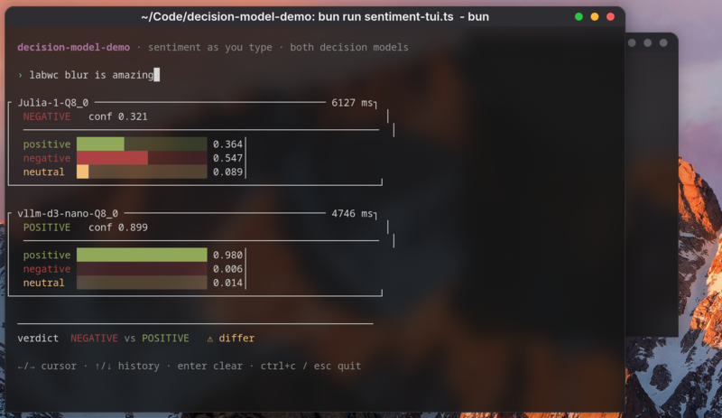
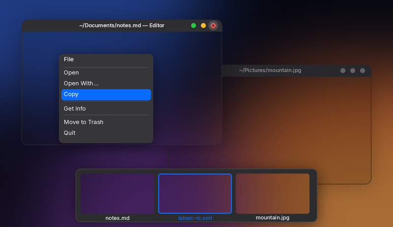

# macos-dark

A macOS-inspired dark theme for the [labwc](https://labwc.org) Wayland
compositor: red/yellow/green traffic lights on the right with a centred title,
flat dark titlebars, rounded corners, soft shadows, dark menus and a blurred
background behind clients that request it.

The theme is fully self-contained — every colour lives in its own `themerc`, so
it looks the same on any machine with no other configuration required.



*A screenshot: an active and an inactive window, traffic lights coloured on the
focused window and dimmed to grey on the other, with the window bodies showing
the background blur.*

## Preview



*The same theme rendered by `preview/render-preview.py`: an active and an
inactive window, the context menu and the window-switcher OSD. The close button
is shown hovered, revealing its × glyph. This one is generated from the theme's
own files, so it cannot drift out of sync with them — see
[Regenerating the mock-up](#regenerating-the-mock-up).*

## Layout

```
themes/macos-dark/labwc/
├── themerc               all colours + geometry
├── close-active.svg        ─┐
├── close-inactive.svg       │
├── close_hover-active.svg   │
├── iconify-{active,inactive,hover-active}.svg
├── max-{active,inactive,hover-active}.svg
└── max_toggled-{active,inactive,hover-active}.svg
rc.xml.snippet                    theme + blur + OSD/resize settings for rc.xml
install.sh                        installer
labwc-blur-macos-dark-theme.png   screenshot
preview/render-preview.py         regenerates the mock-up above
preview/theme-mockup.png
```

The SVGs are 10px circles centred in a 20px button, with the hover glyph
(dash / cross / diagonal arrows) drawn in on hover — the macOS behaviour where
the symbol only appears under the cursor.

---

## Requirements

| | |
|---|---|
| **labwc** | Any recent version. The theme uses standard SSD titlebar buttons. |
| **librsvg** | Needed to render the SVG buttons. Check with `labwc --version` — it should list `+rsvg`. Without it labwc falls back to tinted built-in bitmaps and the lights look like plain glyphs instead of circles. |
| **Inter** | The font the theme asks for. Optional — labwc falls back to a generic sans if missing. On Arch: `sudo pacman -S ttf-inter`. |
| **Blur support** | Only for the background blur, and only in `rc.xml.snippet`. Needs a labwc built with the `ext-background-effect-v1` protocol (the stock Arch/CachyOS `labwc` package does not have it). Everything else in the theme works without it. |

---

## Install

### With the script

```sh
git clone https://github.com/grigio/labwc-macos-dark-theme.git ~/Code/labwc-macos-dark-theme
cd ~/Code/labwc-macos-dark-theme
./install.sh
```

This will:

1. Copy the theme to `~/.local/share/themes/macos-dark/` (backing up any
   previous copy).
2. Back up `~/.config/labwc/rc.xml` to `rc.xml.bak.<timestamp>`.
3. Set `<theme><name>macos-dark</name>` in `rc.xml`, creating a `<theme>` block
   if you don't have one, and add the `<blur>` block if it isn't there yet.
   Existing settings are left alone, and re-running the script won't duplicate
   anything.
4. Run `labwc --reconfigure`.

Options:

```sh
./install.sh --theme-only   # only copy the theme files, touch nothing else
./install.sh --no-reload    # patch rc.xml but don't reload labwc
./install.sh --uninstall    # remove the theme files
```

The script honours `XDG_CONFIG_HOME` and `XDG_DATA_HOME`, which makes it easy to
try out in a throwaway environment:

```sh
XDG_CONFIG_HOME=/tmp/test/config XDG_DATA_HOME=/tmp/test/data ./install.sh
```

### Manually

Two steps. Do them in this order or the titlebars will briefly render with
default colours.

**1. Copy the theme files:**

```sh
mkdir -p ~/.local/share/themes/macos-dark
cp -r themes/macos-dark/labwc ~/.local/share/themes/macos-dark/
```

**2. Edit `~/.config/labwc/rc.xml`:**

Set the theme name:

```xml
<theme>
  <name>macos-dark</name>
  ...
</theme>
```

Then merge in the appearance settings from [`rc.xml.snippet`](rc.xml.snippet) —
the `<blur>`, `<windowSwitcher>`, `<resize>` and full `<theme>` blocks. **Paste
the individual blocks into your existing `rc.xml`; do not overwrite the file**,
or you will lose your keybinds, desktop count and monitor setup.

Finally apply it:

```sh
labwc --reconfigure
```

That is also the keybind to rebind if you want one (commonly `W-A-r`).

---

## What the settings do

### Titlebar

```xml
<titlebar>
  <layout>:iconify,max,close</layout>
  <showTitle>yes</showTitle>
</titlebar>
```

The leading `:` is what leaves the left section empty. macOS puts the window
icon on the left and the lights on the right; this theme matches the lights and
title only, so the title stays optically centred instead of being pushed right
by an icon.

`<cornerRadius>12</cornerRadius>` gives the rounded window corners.
`<keepBorder>no</keepBorder>` turns off the 1px border labwc otherwise keeps
around shadowed windows — this theme paints the border in the titlebar colour
instead, so the frame reads as one continuous edge rather than a dark outline.

### Fonts

Inter throughout: 11pt for window titles (semibold when active, medium when
not), 12pt for menus, 11pt for the OSD.

The title is 11pt rather than 10pt on purpose: at 10pt the glyphs are only 17px
tall and the antialiasing looks noticeably soft, while 11pt gives 19px and reads
much crisper. The titlebar height is unchanged either way, because the 20px
traffic lights — not the text — are what set it. This is also why the base font
is 12pt: anything larger would grow the titlebar.

### Blur

```xml
<blur>
  <passes>4</passes>
  <radius>7</radius>
  <noise>0.02</noise>
  <brightness>0.9</brightness>
  <contrast>0.9</contrast>
  <saturation>1.1</saturation>
  <strength>1.0</strength>
</blur>
```

Slightly stronger than the built-in defaults (3 passes, radius 5) for a more
pronounced frosted-glass look. Clients opt in themselves via
`ext-background-effect-v1`; labwc only blurs behind windows that ask for it, so
windows without backdrop support stay fully opaque.

Delete the block to go back to the defaults. Tuning notes:

- `passes` / `radius` — how far the blur reaches. Higher is prettier and slower.
- `strength` — overall opacity of the blur, `0` disables it entirely.
- `saturation` — above `1.0` keeps the wallpaper's colour visible through the
  blur instead of washing out to grey.

---

## `themerc-override` wins over this theme

labwc reads theme files in this order:

1. `~/.local/share/themes/macos-dark/labwc/themerc` (this theme)
2. `~/.config/labwc/themerc-override` — **read last, wins**

If you use anything that generates `themerc-override` (a shell theme, a
palette-sync script, a wallpaper palette tool), those colours will be layered on
top of this theme and **will** override it. That is the intended way to retint
the theme, but it also means a surprising colour is far more likely to come from
there than from the theme itself.

Check it first:

```sh
ls -l ~/.config/labwc/themerc-override
```

Since `themerc-override` is read after the theme, you only need to put the
settings you want to change in it — everything else falls through to this theme.

---

## Regenerating the mock-up

The image in the **Preview** section is produced by `preview/render-preview.py`,
which reads the colours out of `themes/macos-dark/labwc/themerc`, takes the
geometry and blur tuning from `rc.xml.snippet`, and rasterises the traffic lights
straight from the theme's SVGs — so it tracks the theme rather than being kept in
sync by hand. After changing a colour, re-run it:

```sh
python3 preview/render-preview.py
```

Options: `--width` (default 800) and `--out`.

Needs `pillow`, `rsvg-convert` (librsvg) and the Inter font. If Inter lives
somewhere unusual, point `FONT_PATH` at `InterVariable.ttf`.

The mock-up is drawn in output pixels, so the blur radius is read at output
resolution rather than native — that keeps the effect visible at README size
instead of shrinking to a 3px haze. Window bodies show the blurred wallpaper
because that is what a client asking for backdrop blur gets; the wallpaper itself
is the one thing the script invents.

The screenshot at the top of this file is a real capture and is **not** generated
by this script.

---

## Troubleshooting

**Buttons are plain glyphs, not coloured circles**
labwc was built without librsvg. Confirm with `labwc --version` — you need
`+rsvg`. The fallback tints in `themerc` keep the colours, but you lose the
circle shape and hover glyphs.

**No blur behind windows**
Either labwc lacks `ext-background-effect-v1`, or the client never requested
it. Not every toolkit exposes backdrop blur; check the specific app.

**Wrong colours**
Almost always `themerc-override` (see above).

**Everything still looks default after installing**
You copied the theme but never set `<theme><name>macos-dark</name>`, or labwc
was not reconfigured. Run `labwc --reconfigure`.

**Titlebar too tall or text too small**
The geometry is tuned for Inter at the sizes above. If Inter is missing, the
font fallback has different metrics and the titlebar will not line up as
intended.

---

## Uninstall

```sh
./install.sh --uninstall
labwc --reconfigure
```

Then remove the `<blur>`, `<windowSwitcher>`, `<resize>` and `<theme>` blocks you
added to `rc.xml`, or restore the backup the installer made
(`~/.config/labwc/rc.xml.bak.<timestamp>`).